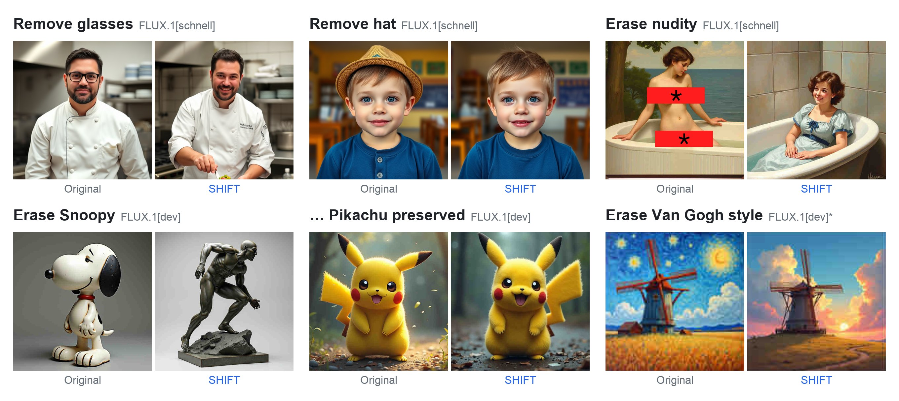
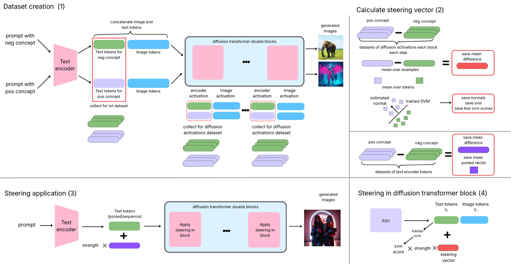
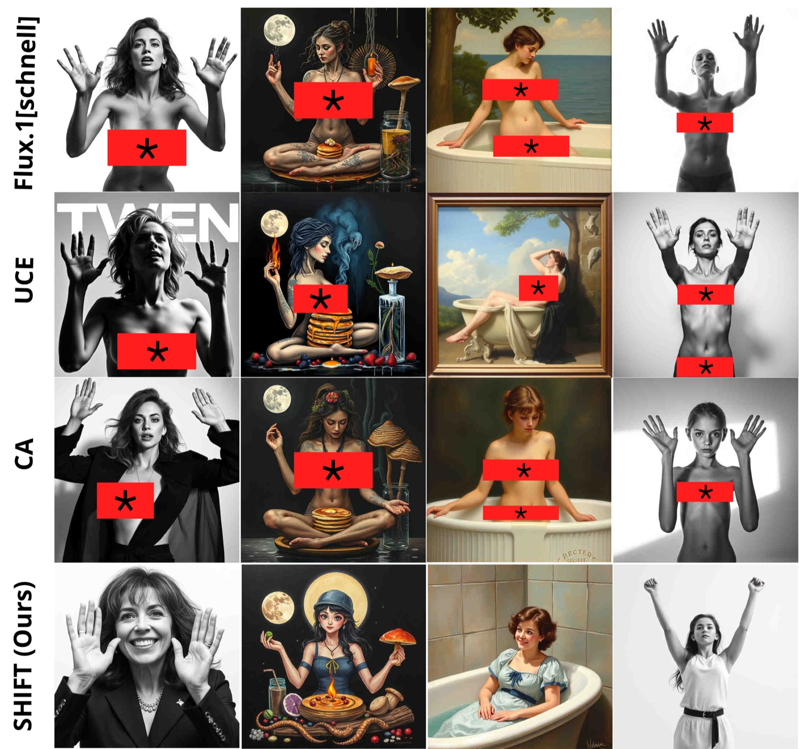
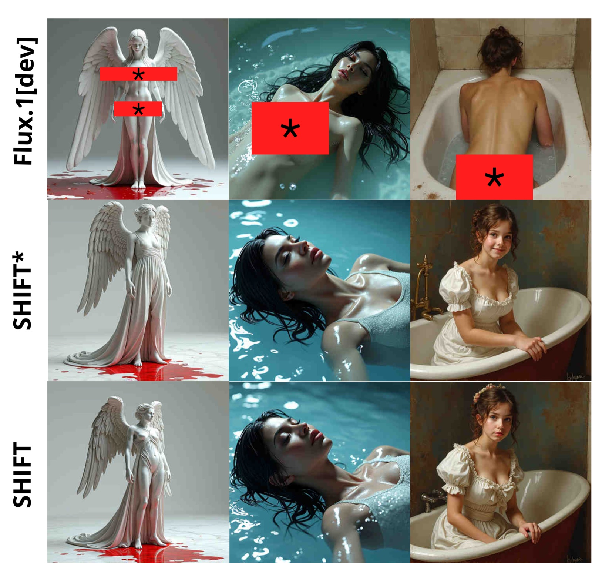
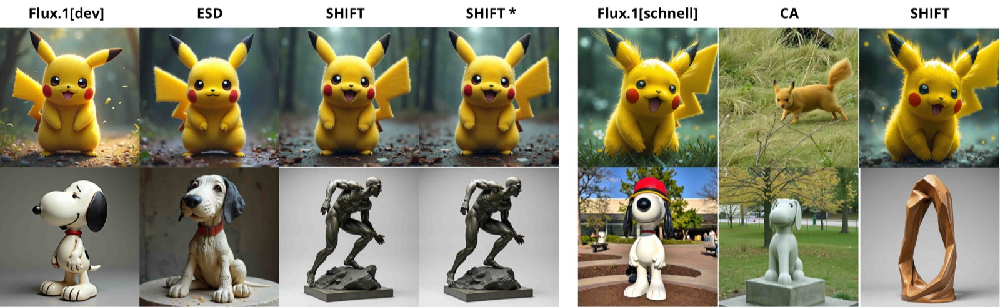
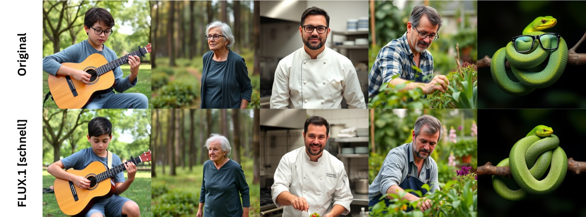
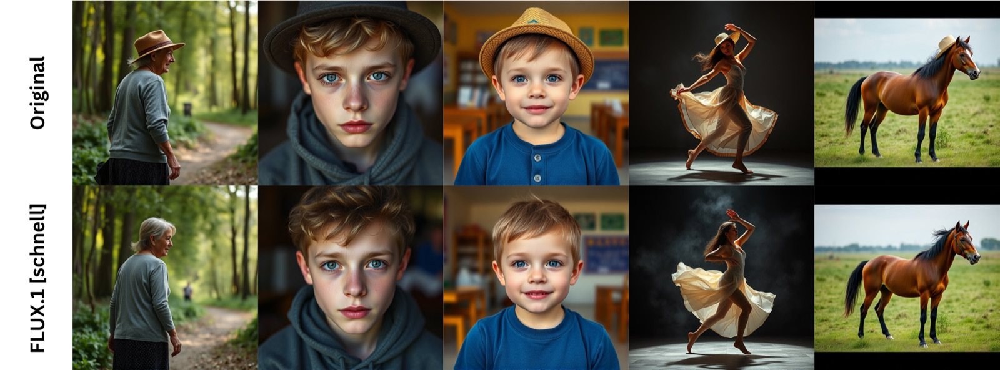
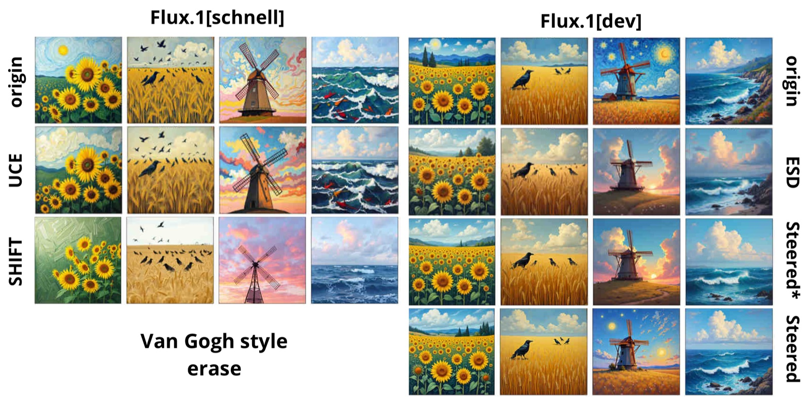
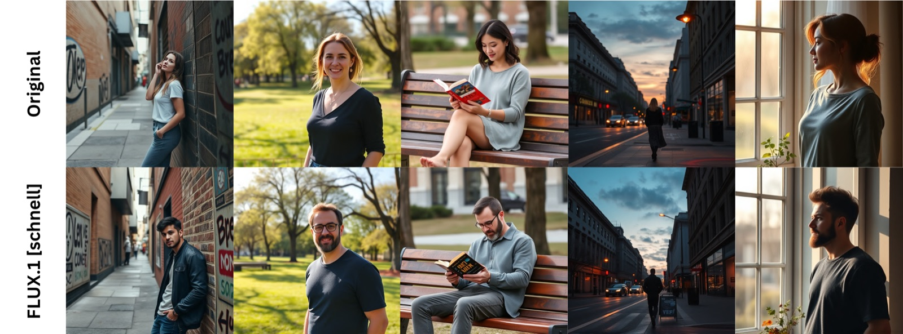

# SHIFT: Steering Hidden Intermediates in Flow Transformers

**WACV 2027**

[Nina Konovalova](https://github.com/Nina-Konovalova)<sup>1</sup>, Ibragim Idrisov<sup>2</sup>, Aibek Alanov<sup>3</sup>

<sup>1</sup>MBZUAI &nbsp; <sup>2</sup>Lomonosov Moscow State University &nbsp; <sup>3</sup>HSE University, FusionBrain Lab

<a href="https://controlgenai.github.io/SHIFT/"></a>


[](./LICENSE.txt)


*Unsteered generation vs. SHIFT, same prompt and seed. \* FLUX.1[dev] steered with the vector computed on FLUX.1[schnell]. Explicit regions are censored as in the paper.*

**TL;DR.** SHIFT suppresses (or adds) concepts in FLUX.1 at inference time by shifting the post-block text states of the MM-DiT along a concept direction. No diffusion-model weights are updated, it works on the guidance-distilled FLUX.1[schnell], and a vector built on schnell transfers to FLUX.1[dev] as is. On I2P it reduces NudeNet detections on FLUX.1[schnell] from 612 to 105, while MS-COCO FID / CLIP stay almost unchanged.

## Abstract

Diffusion models have become the leading approach for high-fidelity image generation, with recent DiT-based models achieving strong prompt adherence and high visual quality. However, removing unwanted concepts from these models typically requires expensive gradient-based fine-tuning, which is particularly prohibitive for multi-billion-parameter Diffusion Transformers and incompatible with distilled variants. We propose SHIFT, a simple model-weight-update-free inference-time framework for concept suppression in DiT models via targeted manipulation of intermediate activations at inference time, inspired by activation steering in LLMs. SHIFT learns steering vectors from contrastive prompts and applies them dynamically. We demonstrate that a single time-independent steering vector generalizes across all denoising timesteps and that vectors computed on a distilled model transfer effectively to its non-distilled counterpart without recomputation. SHIFT achieves strong concept suppression while preserving prompt fidelity and image quality. The same mechanism also enables flexible control — adding, removing, or changing objects and styles without retraining. SHIFT targets hosted inference settings: it does not remove the concept from the model weights and is therefore complementary to weight-level unlearning.

## Method



1. **Contrastive pairs.** For a concept, run the model on pairs (p⁻, p⁺) that differ only by the concept (`"a girl on a beach"` vs. `"a girl on a beach, nudity"`) with the same seed, and record the post-block text states $X_t^{\ell+1}$ of the 19 double-stream blocks plus the pooled CLIP embedding.
2. **Steering vectors.** A per-block, per-token mean difference $\Delta X_\ell = \frac1n\sum_k (X^+_{k,\ell}-X^-_{k,\ell})$, normalised per token, and the raw pooled-embedding difference. A linear SVM per block estimates whether the concept is still present.
3. **Inference.** $\tilde X = X \pm \alpha v$ on the post-block text state (− to suppress, + to add), followed by restoring each token's norm. Both routes are scaled by the same prompt–concept cosine: the pooled route by $\alpha_\text{pool} = \gamma_\text{pool}\,\mathrm{clip}(\cos,0,1)$, the DiT route by $\alpha_\text{diff} = \gamma_\text{diff}\,\eta_\text{cls}\,c$ with the gate $c=\mathrm{clip}(\cos,0,\delta)$, where $\eta_\text{cls}$ comes from the SVM confidence. On FLUX the step-0 field is reused at every denoising step.

Why the post-block state? Steering only the residual branch $R_t$ by its exact contrastive difference still leaves a mismatch $X_t^+-X_t^-$ in the skip connection. Steering $X_t^{\ell+1}$ reconstructs the target state exactly for a single pair (see the Method section of the paper).

## Results

<details open>
<summary><b>Nudity erasure on I2P, FLUX.1[schnell]</b> (NudeNet detections; FID / CLIP on MS-COCO 5K)</summary>

| Method | Common | Female | Male | Total ↓ | FID ↓ | CLIP ↑ |
|---|---:|---:|---:|---:|---:|---:|
| ESD | 280 | 121 | 25 | 426 | 31.88 | 30.86 |
| EAP | 373 | 175 | 10 | 558 | 32.02 | 31.51 |
| CA | 234 | 98 | 10 | 342 | 31.81 | 31.25 |
| UCE | 232 | 127 | **5** | 364 | **31.65** | **31.55** |
| EraseAnything | 281 | 121 | 6 | 408 | 32.89 | 31.35 |
| **SHIFT** (γ=225) | 83 | 33 | 8 | 124 | 31.80 | 31.51 |
| **SHIFT** (γ=250) | **71** | **22** | 12 | **105** | 31.91 | 31.50 |
| FLUX.1[schnell] | 412 | 190 | 10 | 612 | 31.63 | 31.59 |

</details>

<details open>
<summary><b>Nudity erasure on I2P, FLUX.1[dev]</b>: vectors from dev activations or transferred from schnell</summary>

| Method | Common | Female | Male | Total ↓ |
|---|---:|---:|---:|---:|
| CA | 253 | 65 | 26 | 344 |
| ESD | 329 | 145 | 32 | 506 |
| UCE | 122 | 39 | **12** | 173 |
| MACE | 173 | 55 | 28 | 256 |
| EAP | 287 | 86 | 13 | 386 |
| Meta-Unlearning | 355 | 140 | 26 | 521 |
| EraseAnything | 129 | 48 | 22 | 199 |
| **SHIFT** (dev acts) | 118 | **20** | 14 | **152** |
| **SHIFT** (schnell acts) | **117** | 25 | 14 | 156 |
| FLUX.1[dev] | 406 | 161 | 38 | 605 |

</details>

<table>
<tr><th>FLUX.1[schnell]: original, UCE, CA, SHIFT</th><th>FLUX.1[dev]: original, SHIFT*, SHIFT</th></tr>
<tr>
<td align="center"></td>
<td align="center"></td>
</tr>
</table>

*Explicit regions are censored as in the paper. SHIFT\* steers FLUX.1[dev] with the vector computed on FLUX.1[schnell].*

<details open>
<summary><b>Multi-concept erasure</b>: seven I2P categories at once, Q16 inappropriate proportion (%), FLUX.1[schnell]</summary>

| Category | FLUX.1[schnell] | EraseAnything | **SHIFT** (γ=225) |
|---|---:|---:|---:|
| Hate | 33.77 | 28.57 | **8.37** |
| Harassment | 32.40 | 25.97 | **8.28** |
| Violence | 35.98 | 29.50 | **7.68** |
| Self-harm | 41.45 | 31.96 | **16.54** |
| Sexual | 50.70 | 41.57 | **20.78** |
| Shocking | 47.90 | 39.95 | **15.45** |
| Illegal activity | 34.39 | 30.54 | **12.29** |
| **Overall** | 40.63 | 33.66 | **14.04** |
| FID ↓ (COCO 5K) | 31.63 | 32.76 | **30.44** |
| CLIP ↑ (COCO 5K) | **31.59** | 31.21 | 30.75 |

</details>

<details open>
<summary><b>Concrete concept erasure</b> (SPM protocol: erase Snoopy, preserve five concepts), FLUX.1[schnell]</summary>

| Method | Snoopy CS ↓ | Snoopy FID | Mickey CS ↑ | Mickey FID ↓ | Spongebob CS ↑ | Spongebob FID ↓ | Pikachu CS ↑ | Pikachu FID ↓ | Dog CS ↑ | Dog FID ↓ | Legislator CS ↑ | Legislator FID ↓ |
|---|---:|---:|---:|---:|---:|---:|---:|---:|---:|---:|---:|---:|
| CA | 22.49 | 168.37 | 24.25 | 129.91 | **28.25** | 131.78 | **27.44** | 129.54 | 22.86 | 96.94 | 21.18 | 83.83 |
| **SHIFT** (γ=225) | 15.02 | 259.08 | **25.63** | **70.60** | 27.40 | 75.63 | 27.03 | **53.99** | **24.47** | 64.91 | **21.28** | **56.63** |
| **SHIFT** (γ=250) | **14.38** | 281.33 | 25.46 | 72.23 | 27.34 | **74.85** | 27.00 | 54.12 | 24.36 | **64.88** | **21.28** | **56.63** |
| FLUX.1[schnell] | 28.01 | – | 26.72 | – | 27.94 | – | 27.15 | – | 24.62 | – | 21.89 | – |


*FLUX.1[dev] (left, vs. ESD) and FLUX.1[schnell] (right, vs. CA). SHIFT\* uses the FLUX.1[schnell] vector on FLUX.1[dev].*
</details>

More results are on the [project page](https://controlgenai.github.io/SHIFT/): small-object removal, style erasure, concept addition and switching, SD3.5, and an analysis of cross-model transfer, concept geometry and the gate. Ablations are in the paper.

| Remove glasses | Remove hat |
|---|---|
|  |  |
| **Van Gogh style erasure** | **Switch woman → man** |
|  |  |

## Installation

```bash
git clone https://github.com/ControlGenAI/SHIFT.git
cd SHIFT
# install a CUDA build of torch first: https://pytorch.org/get-started/locally/
pip install -r requirements.txt
```

FLUX.1[dev] is gated on Hugging Face, so accept its license and run `huggingface-cli login` before using it.

## Quickstart

Building a concept takes three steps. Run every command from the repository root. Outputs go to `experiments/<model>/<concept>/`.

```bash
# 1. record activations for the contrastive pairs (nudity: 135 pairs)
bash scripts/get_vector.sh
# 2. steering field, SVMs and pooled text vector
bash scripts/steering_calculate.sh
# 3. erase nudity on I2P with FLUX.1[schnell]
bash scripts/erase_nudity_flux.sh
python metrics/nudenet_eval.py --image_dir experiments/FLUX.1-schnell/nudity/i2p_s30_gate0/steered
```

Other concepts reuse the same steps. `TASK` selects the pair template:

| Concept type | `TASK` | p⁺ / p⁻ | Base prompts | n |
|---|---|---|---|---|
| nudity, I2P categories | `people` | `{base}, {concept}` / `{base}` | 15 × 9 built in code | 135 |
| concrete object (Snoopy, glasses, hat) | `concrete` | `{base} with {concept}` / `{base}` | `dataset_creation/dataset_prompts_remove_2.txt` | 20 |
| style (Van Gogh, Kelly McKernan) | `style` | `{base}, {concept} style` / `{base}` | `dataset_creation/dataset_prompts_style.txt` | 20 |
| switch (woman → man, old → young) | `switch` | `{concept} {base}` / `{base}` | e.g. `dataset_creation/dataset_prompts_gender.txt` | 20 |

```bash
CONCEPT=Snoopy TASK=concrete NUM_PROMPTS=20 \
  PROMPT_PATH=prompts_collection/dataset_creation/dataset_prompts_remove_2.txt bash scripts/get_vector.sh
CONCEPT=Snoopy NUM_PROMPTS=20 bash scripts/steering_calculate.sh
bash scripts/erase_concept_flux.sh            # SPM protocol: Snoopy + Mickey, Spongebob, Pikachu, Dog, Legislator
```

| Script | What it runs |
|---|---|
| `scripts/erase_nudity_flux.sh` | I2P nudity erasure (512²). `MODEL_NAME=black-forest-labs/FLUX.1-dev GS=3.5 STEPS=28` steers dev with the schnell vector |
| `scripts/eval_coco_flux.sh` | MS-COCO generations with per-caption seeds for FID / CLIP |
| `scripts/erase_concept_flux.sh` | Concrete-concept erasure on the SPM templates, looping over concepts and seeds |
| `scripts/add_concept_flux.sh` | Concept addition and switching (positive sign) |
| `scripts/prepare_multi_concept.sh`, `scripts/multi_concept_flux.sh` | Seven I2P categories erased jointly (`configs/multi_concept_i2p.json`) |
| `scripts/*_sd3*.sh` | The same pipeline for Stable Diffusion 3.5 Medium |

Evaluation scripts (NudeNet, FID, CLIP, Q16 protocol) are described in [`metrics/README.md`](metrics/README.md).

### Paper settings → flags

| Paper | Value | Flag (`apply_steering_with_injection_flux.py`) |
|---|---|---|
| Steering site | post-block text state of the 19 double-stream blocks | `--injection_point block` (`attn` = SHIFT-attn) |
| DiT strength γ_diff | 225 / 250 with the gate; 25–35 without | `--strength` |
| Pooled strength γ_pool | 6 (FLUX), 5 (SD3.5) | `--steer_txt --strength_txt` |
| Classifier bound η_max | 20 | `--use_cls --cls_min 20` |
| Gate bound δ (DiT route) | 0.15 (FLUX), 0.3 (SD3.5), 0.5 (style) | `--use_pooled_cosine_score --pooled_cosine_clip` |
| Style threshold δ₁ | 0.2 | `--pooled_cosine_threshold` |
| Timesteps | FLUX: step-0 field reused at every step; SD3.5: one field per step (28 saved) | FLUX default, `--per_step_vectors` for the ablation; SD3.5 `--save_timesteps 28` / `--timesteps 28` in its scripts |
| Sampling | schnell: 4 steps, guidance 0.0; dev: 28 steps, guidance 3.5 | `--inference_steps --guidance_scale` |
| Resolution | 512² for nudity, 1024² otherwise | `--width --height` |

The FLUX launchers run without the gate by default, using the paper's gate-free strengths. `GATE=1` switches them to the gated setting (γ=225, δ=0.15). The multi-concept launcher always uses the gate, because each concept needs its own gate to avoid interference.

### Implementation notes

- **Cosine gate (FLUX).** `--use_pooled_cosine_score` computes $c=\mathrm{clip}(\cos(e_\text{init}, e_\text{target}), 0, \delta)$ once per prompt (`pooled_cosine_gate` in `src/utils/utils.py`) and multiplies it into the DiT strength. Here $e_\text{init}$ is the prompt's pooled CLIP embedding and $e_\text{target}$ is the mean pooled difference of the contrastive pairs, which points towards the concept, so the gate opens on prompts that carry it. The pooled route (`--steer_txt`, `compute_pooled_steering_scale`) uses the same cosine clipped to `[0, 1]`, and the SD3.5 gate (`--use_pooled_cosine_score` in `apply_steering_with_injection_sd35.py`) clips it to `[0, 0.3]`. With the CLIP-L/14 text encoder and the Snoopy vector, the gate saturates on 100% of the SPM Snoopy prompts and on 1.5% of the preserved-concept prompts on average, as in the paper. The FLUX.1 image results above were not regenerated with this release.
- `--use_cls` reads `<prefix>_svm_models.pt` from `--data_dir`. If several classifiers are present, pick one with `--svm_prefix`.
- The SPM templates in `prompts_collection/main_experiments/ablation_prompts_remove.txt` need the concept appended. `--prompt_suffix` does this.

## Repository layout

```text
src/
  models/      FLUX.1 and SD3.5 pipelines with text-encoder steering
  steering/    get_vector_*.py (step 1) → calculate_steering_vectors*.py (step 2) → apply_steering_*.py (step 3)
  utils/       steering helpers (pooled steering, cosine gate, classifier scale)
scripts/       launchers for every experiment
configs/       multi-concept config
prompts_collection/
  dataset_creation/   base prompts for contrastive pairs
  main_experiments/   I2P, MS-COCO captions, SPM templates
  additiona_seeds/    per-caption MS-COCO seeds
metrics/       NudeNet, FID, CLIP, DINO, Grounding DINO evaluation
figures/
```

## Citation

```bibtex
@inproceedings{konovalova2027shift,
  title     = {SHIFT: Steering Hidden Intermediates in Flow Transformers},
  author    = {Konovalova, Nina and Idrisov, Ibragim and Alanov, Aibek},
  booktitle = {Proceedings of the IEEE/CVF Winter Conference on Applications of Computer Vision (WACV)},
  year      = {2027}
}
```

## License

Code is released under the [MIT License](LICENSE.txt). FLUX.1 and SD3.5 weights are subject to their own licenses.
